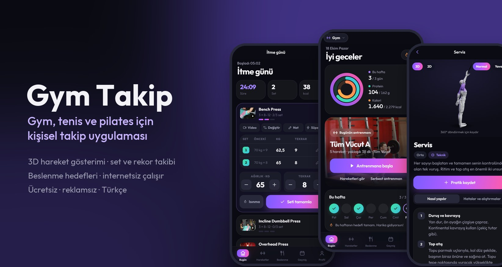
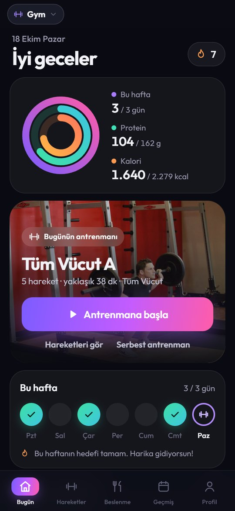
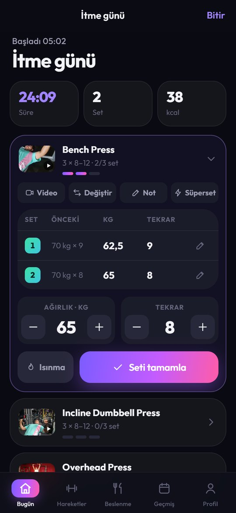
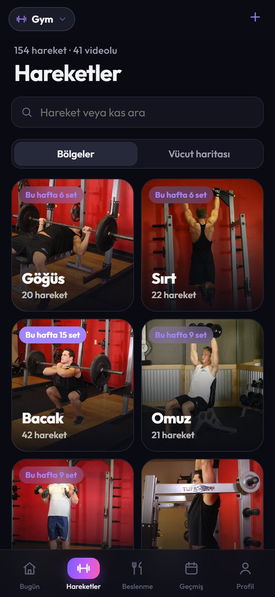
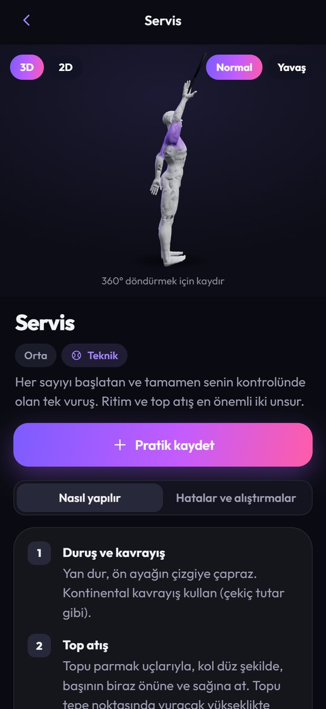
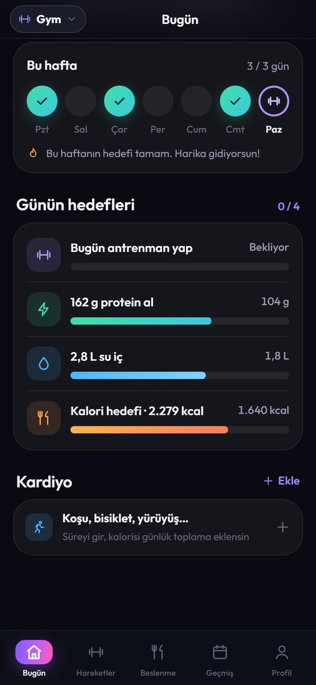
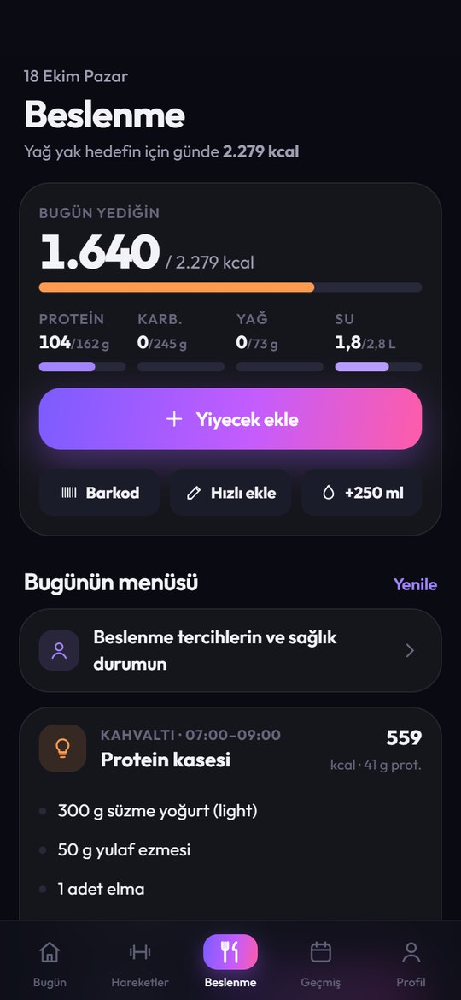
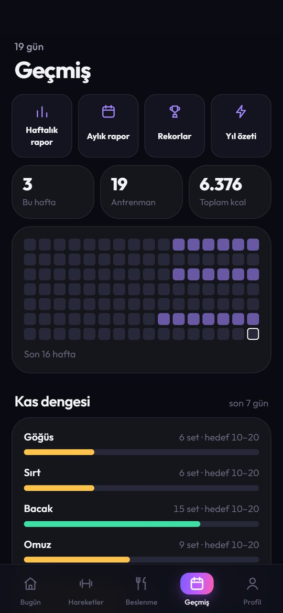
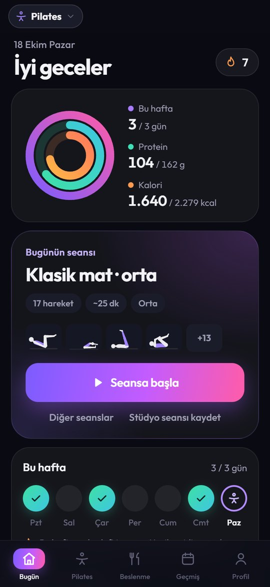

# Gym Takip

**Gym, tenis ve pilates için kişisel takip · gerçek egzersiz videoları · parmakla döndürülebilen 3D hareket gösterimi · kişisel program ve beslenme planı.**
iPhone ve Android'de uygulama gibi çalışan, **internet olmadan da kullanılabilen** ücretsiz bir web uygulaması (PWA).

**▶ Uygulamayı aç: [korkmazgozc.github.io/gym](https://korkmazgozc.github.io/gym/)**



## Özellikler

İlk açılışta sporunu seçersin (**Gym**, **Tenis** veya **Pilates**); uygulama seçtiğin spora göre şekillenir. Sporu istediğin zaman sol üstteki spor düğmesinden tek dokunuşla değiştirebilirsin.

**Tenis**
- Maç kaydı: set set skor (tie-break ve süper tie-break), rakip ve seviyesi, isteğe bağlı ace / çift hata / winner / unforced error
- İstatistikler: galibiyet ve oyun kazanma oranı, tie-break ve 3 setlik maçlar, son 5 maç formu, rakiplere karşı geçmiş, zemine göre sonuçlar ve **kişisel seviye tahmini**
- 9 vuruş tekniği (forehand, backhand, servis, vole, smaç…) 360° döndürülebilen 3D gösterim, adım adım anlatım, sık yapılan hatalar ve alıştırmalarla
- Tenise özel 3 kondisyon programı: alt vücut ve çeviklik, omuz koruma (rotator cuff), core ve rotasyon
- Rehberli maç öncesi ısınma ve maç sonrası esneme rutinleri (süreli, sesli uyarılı)

**Pilates**
- 29 mat ve 9 reformer hareketi 3D gösterimle (reformer aleti dahil, istersen 2D çizim); nefes, ipuçları, kolaylaştırma ve zorlaştırma
- Seviyeye göre hazır seanslar ve rehberli akış: hareketler sırayla, süreli ve sesli uyarıyla ekrana gelir
- Stüdyo (reformer) seanslarını kaydetme

**Gym**

**Antrenman**
- Hedefine ve haftada kaç gün spor yapabildiğine göre **otomatik program** (Tüm Vücut, Üst/Alt, İtme/Çekme/Bacak) ya da kendi programın
- Antrenman ekranında set set kayıt: önceki antrenmanın değerleri, ısınma setleri, **dinlenme sayacı**
- **İlerleme önerisi:** geçen sefer hedef tekrarların hepsini yaptıysan ağırlığı artırmayı, yapamadıysan tekrarı artırmayı önerir
- **Hareket değiştirme:** makine doluysa aynı kası çalıştıran alternatiflerden birine tek dokunuşla geç
- **Süperset:** iki hareketi art arda yap; uygulama aradaki dinlenmeyi atlar, tur bitince dinlenme başlar
- **Rekor kutlaması:** rekor kırdığın anda önceki en iyinle birlikte gösterilir
- **Notlar:** harekete kalıcı not (makine ayarı, tutuş) ve antrenmana günlük not
- Antrenman özeti: süre, yakılan kalori, toplam kaldırılan ağırlık, rekorlar
- **Hatırlatıcılar:** antrenman günlerin iPhone Takvim'e bildirimli etkinlik olarak eklenir; su/protein bildirimi için Kestirmeler rehberi

**Hareketler**
- 6 bölgede ve 21 alt grupta (biceps, triceps, ön kol, üst göğüs…) **154 hareket**, Türkçe adlarıyla (uluslararası adı altında)
- Her harekette **parmakla döndürülebilen 3D gösterim**: halter, dambıl, sehpa, kablo, barfiks barı gibi ekipmanlarla; çalışan kas renkli. 41 harekette ayrıca gerçek **video**, diğerlerinde fotoğraf
- Ekipmana göre filtre (halter, dambıl, makine, kablo, vücut ağırlığı)
- Akıllı arama: Türkçe/İngilizce ikinci isimler ve takma adlar ("barfiks" = "pull up", "lat çekiş"), Türkçe karakter ve yazım hatası toleransı
- Adım adım anlatım, ipuçları, çalışan ana ve yardımcı kaslar
- **Dokunulabilir vücut haritası:** bir kasa dokununca o kasın hareketleri açılır; kaslar son 7 günde yaptığın set sayısına göre renklenir
- Hareket başına grafikler: en ağır set, tahmini maksimum, toplam kaldırılan

**Vücut ve beslenme**
- Boy, kilo ve yaşa göre günlük kalori ihtiyacı, protein hedefi, vücut kitle indeksi, tahmini yağ oranı
- Hedefe göre (yağ yakma, formu koruma, kas kazanma) **günlük örnek menü**; porsiyonlar kalori ve protein hedefine göre ayarlanır
- Vejetaryen veya "et yok, balık var" seçeneği, yemediğin yiyecekleri çıkarma
- **Sağlık durumuna göre uyarlama:** diyabet, yüksek tansiyon, yüksek kolesterol, çölyak, laktoz intoleransı, gut, reflü, hamilelik ve böbrek hastalığı için menü, kalori/protein hedefi, beslenme ve antrenman önerileri
- **Yemek kaydı:** 539 yaygın Türk yemeği ve besinde arama (mercimek çorbası, simit, ayran…), ev ölçüleriyle porsiyon (adet, dilim, kase, kepçe, yemek kaşığı), öğünlere göre liste, son yenenler
- **Kaynağı belli besin değerleri:** tek malzemeli besinler doğrudan USDA FoodData Central'dan (kamu malı); Türk yemekleri USDA malzeme değerleri ve standart ev tarifleriyle hesaplanır (pişirmedeki ağırlık değişimi dahil)
- **Kendi tarifim:** 70 ham malzemeden kendi yemeğini oluştur; pişmiş ağırlık ve porsiyon sayısına göre değerler hesaplanır
- **Barkod okuma:** paketli ürünler Open Food Facts'ten bulunur ve telefonda saklanır; okuyucu uygulamayla birlikte gelir
- Kalori, protein, karbonhidrat, yağ ve su takibi; kardiyo kaydı; kilo ve vücut ölçüsü takibi

**Geçmiş ve motivasyon**
- **Haftalık seri:** her hafta en az bir gün spor yaparsan seri sürer; bir haftayı kaçırırsan ertesi hafta 2 günle kurtarabilirsin
- **Haftalık ve aylık raporlar:** aktif gün, süre, kalori, set, toplam kaldırılan, tenis ve pilates; önceki dönemle karşılaştırma, kırılan rekorlar, kas gruplarına göre set
- **Rekorlar sayfası:** her hareket için en ağır, tahmini maksimum, en iyi set ve seans, 1/3/5/8/10 tekrar rekorları
- **Yıl özeti:** yılın aktif günleri, saatleri, rekorları, en çok güçlendiğin hareketler; paylaşılabilir görsel
- Antrenman takvimi ve bölgelere göre **kas dengesi**

**Ses ve ekran**
- Rehberli seanslarda **Türkçe sesli rehber** ("Sıradaki: …", "Başla", "Yarısı bitti")
- İsteğe bağlı **kilit ekranında dinlenme sayacı** (ses çalarak sayar) ve antrenmanda ekranın açık kalması

| | | | |
|:-:|:-:|:-:|:-:|
|  |  |  |  |
| Bugün | Antrenman | Hareketler | 3D hareket (tenis servisi) |
|  |  |  |  |
| Hafta ve günün hedefleri | Beslenme | Geçmiş | Pilates modu |

## Telefona kurulum

**iPhone:** Linki **Safari** ile aç → alttaki **Paylaş** düğmesi → **Ana Ekrana Ekle**.
**Android:** Linki **Chrome** ile aç → sağ üstteki menü → **Ana ekrana ekle**.

İlk açılışta kısa bir kurulum (hedef, haftalık gün sayısı, boy, kilo ve yaş) programını ve beslenme hedeflerini hazırlar.

### İnternetsiz kullanım
Uygulama ve fotoğraflar ilk açılışta telefona kaydedilir. Videolar yer kapladığı için (~62 MB) ayrıca indirilir:
**Profil → ⚙ Ayarlar → İnternetsiz kullanım → İnternetsiz kullanım için indir** (Wi‑Fi'dayken yapman önerilir). Sonrasında uygulama uçak modunda da tamamen çalışır.

## Verilerin

- Tüm kayıtlar **sadece kendi telefonunda** saklanır; hiçbir sunucuya gönderilmez, hesap gerekmez.
- Uygulamayı ana ekrandan silersen verilerin de silinir. **Ayarlar → Yedek al** ile ara sıra yedek alıp iCloud Drive'a veya Google Drive'a kaydet; **Yedeği geri yükle** ile geri yükleyebilirsin.

> Kalori ve beslenme değerleri yaklaşık hesaplardır; menü örnek niteliğindedir ve bir diyetisyen planı yerine geçmez. Sağlık durumuna göre yapılan uyarlamalar genel önerilerdir; doktor ve diyetisyen önerileri her zaman önceliklidir.

## Teknik

Framework ve derleme adımı olmadan düz HTML, CSS ve JavaScript (ES modülleri) ile yazıldı.

| Dosya | İçerik |
|---|---|
| `index.html`, `styles.css` | Uygulama iskeleti ve tasarım |
| `app.js` | Ekranlar, antrenman, program, hesaplamalar |
| `exercises.js` | 138 hareketin bilgileri, alt grupları, ekipmanı, görselleri ve videoları |
| `nutrition.js` | Yiyecek değerleri ve menü oluşturucu |
| `bodymap.js` | Ön ve arka vücut haritası (SVG) |
| `sports.js` | Tenis ve pilates içerikleri: vuruşlar, programlar, rutinler, seanslar |
| `figure.js` | Hareketli çizim motoru (2D figür, reformer) |
| `figure3d.js` | 3D gösterim: pozları insan modelinin iskeletine uygular, salon ekipmanı, kas vurgusu, 360° döndürme |
| `gymfigs.js` | 154 gym hareketinin 3D pozları ve ekipmanı |
| `models/` | 3D insan modeli (Quaternius, CC0) |
| `foods.js` | Yiyecek veritabanı (539 besin + 115 malzeme, ev ölçüleri); `tools/build_foods.py` üretir |
| `tools/build_foods.py` | Besin değerlerini USDA verisinden ve Türk tariflerinden hesaplar (`tools/usda_subset.json`) |
| `tools/screenshots.py` | README ekran görüntülerini örnek verilerle üretir (`tools/shot.html`, headless Chrome) |
| `vendor/` | Barkod okuyucu: barcode-detector ve zxing-wasm (MIT); three.js (MIT) |
| `sw.js` | Service worker: çevrimdışı önbellek, video indirme |
| `img/`, `vid/` | Hareket fotoğrafları ve videoları |

**Güncelleme yayınlamak:** Dosyaları değiştirip (yeni görsel eklediysen `python tools/update_sw.py` çalıştırıp) `sw.js` içindeki `VERSION` değerini artır (örn. `gymtakip-v11`) ve `main` dalına gönder. GitHub Pages yeni sürümü birkaç dakika içinde yayınlar. Telefonda uygulamayı kapatıp açınca güncelleme gelir.

**Bilgisayarda çalıştırmak:** Klasörde bir yerel sunucu başlatıp tarayıcıda aç:

```bash
python -m http.server 8765
```

## Görseller ve lisanslar

- **Videolar** (`vid/`): Goulart, [wger.de](https://wger.de) — [CC BY-SA 4.0](https://creativecommons.org/licenses/by-sa/4.0/). 12 saniyeye kısaltıldı ve 540p H.264'e dönüştürüldü.
- **Fotoğraflar** (`img/`): [free-exercise-db](https://github.com/yuhonas/free-exercise-db) — Unlicense (kamu malı). 720 px'e küçültüldü.
- **Besin değerleri:** [USDA FoodData Central](https://fdc.nal.usda.gov) SR Legacy — kamu malı (CC0). Türk yemekleri bu malzeme değerleriyle tariften hesaplanmıştır.
- **Barkodlu ürün verileri:** [Open Food Facts](https://world.openfoodfacts.org) — [ODbL](https://opendatacommons.org/licenses/odbl/1-0/). Uygulama içinde çevrimiçi sorgulanır.
- **3D insan modeli** (`models/`): [Quaternius](https://quaternius.com) Universal Base Characters — CC0 (kamu malı).
- **Yazı tipi** (`fonts/`): [Outfit](https://github.com/Outfitio/Outfit-Fonts) — SIL Open Font License 1.1.
- **3D görüntüleme** (`vendor/three/`): [three.js](https://threejs.org) — MIT.
- **Barkod okuyucu** (`vendor/`): [barcode-detector](https://github.com/Sec-ant/barcode-detector) ve zxing-wasm — MIT; ZXing-C++ — Apache 2.0.
